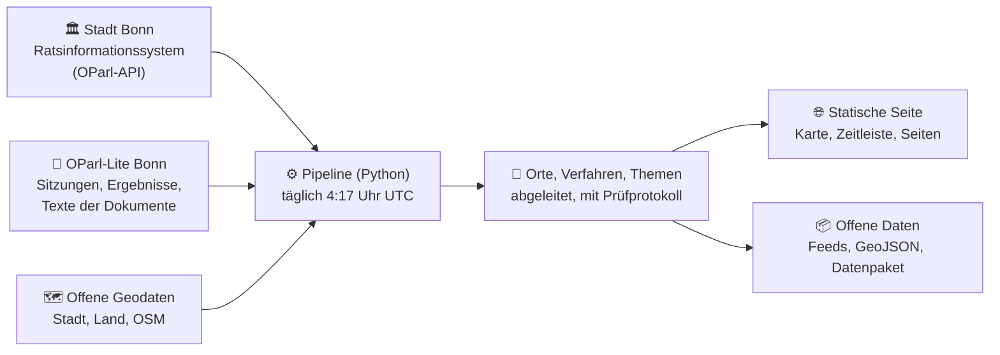

<p align="center"></p>

<h1 align="center">RIS-Karte Bonn</h1>

<p align="center"><strong>Womit befassen sich Rat, Bezirksvertretungen und Ausschüsse der Stadt Bonn – wo, wann und wer ist beteiligt?</strong></p>

<p align="center">
  <a href="https://ris-bonn.datenatlas.de/"></a>
  <a href="https://github.com/daimpad/allris-test/actions/workflows/pages.yml"></a>
  <a href="LICENSE"></a>
  <a href="data/LICENSE-DATA.md"></a>
  <a href="https://ris-bonn.datenatlas.de/rss/"></a>
  
</p>

Die RIS-Karte zeigt die Vorlagen aus dem Ratsinformationssystem der Stadt Bonn auf einer Karte, einer Zeitleiste und als Liste – rund 25.000 Vorlagen seit Oktober 2019, täglich aktualisiert. Jede Angabe führt zum Original; was abgeleitet ist, ist gekennzeichnet.

🌐 **Seite:** https://ris-bonn.datenatlas.de/ · Spiegel: https://daimpad.github.io/allris-test/
📰 **Abonnieren:** [Feeds und Anleitung](https://ris-bonn.datenatlas.de/rss/) · 📦 **Daten:** [Datenpaket (Zip)](https://daimpad.github.io/allris-test/data/export/allris-bonn-export.zip) · 🛠️ **Technik:** [TECHNIK.md](TECHNIK.md)

## 🗺️ Was Sie auf der Seite finden

| | Bereich | Worum es geht |
|---|---|---|
| 🗺️ | **Karte und Liste** | Vorlagen je Ortsteil und Stadtbezirk. Die Flächen zeigen, wo in den letzten zwölf Monaten viel beraten wurde. |
| 🕒 | **Zeitleiste** | Vorlagen je Monat, Sitzungen und Wahlperioden; ein Zeitraum filtert Karte und Liste. |
| 📄 | **Vorgang** | Eine Vorlage mit ihren Stationen: Einreichung, Beratungen mit Ergebnis, Folgevorlagen – und was das Regelwerk vorsieht. |
| ⚖️ | **Prozesse** | Wer entscheidet was? Verfahren mit Schritten und Fristen, Gremien mit Besetzung, Ämter. |
| 🏷️ | **Themenseiten** | Kultur und Haushalt, Verkehr und Mobilität, Schule und Bildung, Wohnen und Bauen, Klima und Umwelt – mit Zeitleiste und nächsten Sitzungen. |
| 💶 | **Haushalt auf einen Blick** | Die Aufwendungen der Stadt als Kacheln; ein Klick zoomt bis zu den Produktgruppen und Aufwandsarten. |
| 📊 | **Zahlen zum Gebiet** | Einwohner, Mieten, Bodenrichtwerte, Haltestellen, Kitas, Hitze, Überschwemmungsgebiete, Wahlbeteiligung, Meldungen im Mängelmelder. |
| 🏗️ | **Bebauungspläne und Baustellen** | Geltungsbereiche der Pläne mit Planchronik, gemeldete Baustellen der Stadt. |
| 🙋 | **Mitmachen** | Nächste Sitzungen, berechnete Fristen und alle Wege, sich einzubringen – mit Rechtsgrundlage. |
| 📰 | **Feeds und Kalender** | Neues für ganz Bonn, je Gebiet, Thema oder Vorgang im Feed-Reader; Sitzungen als Kalenderdatei. |
| 🔍 | **Suche** | Nach Titel und Drucksache in ganz Bonn, auf Wunsch auch im Text der Dokumente. |
| 🤖 | **Ratsassistent** | Fragen in eigenen Worten; ein Sprachmodell antwortet nur mit den Daten der Seite (eigener Schlüssel nötig). |

Neu auf der Seite? Das Fenster „Los geht's“ startet eine Tour durch alle Funktionen.

## 🔄 So entsteht die Karte



1. **Abruf:** Vorlagen, Beratungen, Gremien und Ämter kommen aus der OParl-API der Stadt, Sitzungen und Ergebnisse aus OParl-Lite.
2. **Verortung:** Die Stadt nennt nur bei etwa 8 % der Vorlagen einen Ort. Die übrigen Orte erschließt die Pipeline aus Straßen-, Orts- und Gebäudenamen im Titel, aus Bebauungsplan-Nummern und aus dem Text der Dokumente.
3. **Einordnung:** Stand des Verfahrens, Themen und Einreichende werden nach festen Regeln abgeleitet – jede Zuordnung mit Grund.
4. **Veröffentlichung:** Eine statische Seite ohne Server-Logik, dazu Feeds, Kalender und Datenpaket.

## ✅ Wie verlässlich sind die Angaben?

- **Orte** tragen eine Sicherheit: 🟢 *gesichert* (Koordinate der Stadt oder eindeutiger Bebauungsplan), 🟠 *erschlossen* (Name im Titel), 🟣 *unsicher* (Name passt auf mehrere Orte). Etwa 57 % der Vorlagen haben keinen erkennbaren Ort.
- **Schritte eines Verfahrens** sind *belegt*, *abgeleitet*, *nicht öffentlich*, *unklar* oder *soll* (vom Regelwerk vorgesehen, in den Daten nicht dokumentiert).
- **Prüfungen von Hand:** Ort richtig bei 41 von 50 Vorlagen in Endenich (4 teilweise, 5 falsch), Themen passend bei 46 von 49, KI-Kurzfassungen zutreffend bei 18 von 30 und teilweise bei 12, keine falsch. Für jede Themenseite und den Haushalt gibt es einen Prüfbogen. Vorprüfungen durch KI sind als solche gekennzeichnet.

<details>
<summary>Mehr zu Orten, Verfahren, Baustellen und Sprachmodellen</summary>

- **Orte** erscheinen nur auf Ebene der Straße oder des Ortsteils, nie mit Hausnummer. Wohnadressen von Privatpersonen werden nicht verortet. Stellungnahmen übernehmen den Ort der Vorlage, auf die sie sich beziehen.
- **Soll nach Regelwerk:** Jeder Vorgang zeigt, welches Verfahren Gemeindeordnung, Geschäftsordnung, Hauptsatzung, Bezirkssatzung und Zuständigkeitsordnung vorsehen. Das Modell stammt aus [„Bonn entscheidet“](https://github.com/anster2025/bonn-entscheidet) ([anster2025](https://github.com/anster2025), MIT) und ist um belegte Schritte ergänzt. Eine Abweichung ist ein Befund, keine Bewertung.
- **Baustellen:** Ob ein Beschluss umgesetzt ist, steht in keiner öffentlichen Schnittstelle. Die Station „Mögliche Umsetzung“ erscheint nur, wenn eine Baustelle sechs Kriterien erfüllt (Nähe, Zeitpunkt, Straße, Amt, Maßnahme, Baubeschluss). Sie ist ein Indiz, kein Beleg.
- **Sprachmodelle:** KI-Kurzfassungen (Mistral) erscheinen gekennzeichnet; maßgeblich ist das Original. Orte aus dem Text per Sprachmodell (Stufe C) sind geprüft, aber nicht freigegeben. Gespeichert werden nur die Ergebnisse, nie Text der Dokumente. Offene Entscheidungen: [`ABNAHME.md`](ABNAHME.md).

</details>

## ⚠️ Grenzen

- Vorlagen vor Oktober 2019 und nichtöffentliche Beratungen fehlen.
- Texte der Dokumente liegen erst für einen kleinen Teil der Vorlagen vor; Auszüge daraus zeigt die Seite nie.
- Ein Straßenpunkt steht für die ganze Straße, nicht für ein Gebäude.
- Berechnete Fristen beruhen auf den Sitzungsterminen; maßgeblich sind Einladung und Geschäftsordnung.
- Das Soll nach Regelwerk ist ein vereinfachtes Modell und keine Rechtsauskunft.

## 📚 Datenquellen und Lizenzen

| Quelle | Inhalt | Lizenz |
|---|---|---|
| 🏛️ [OParl-API der Stadt Bonn](https://www.bonn.sitzung-online.de/oparl/bodies/1) | Vorlagen, Beratungen, Gremien und Besetzung (ohne Kontaktdaten), Ämter, Orte | CC0 1.0 |
| 📑 [OParl-Lite Bonn](https://oparl.bonn.machdenstaat.de/) (machdenstaat) | Sitzung, Tagesordnungspunkt und Ergebnis je Beratung | CC BY 4.0 |
| 🗺️ Stadt Bonn: [Ortsteile und Stadtbezirke](https://opendata.bonn.de/dataset/flächen-der-ortsteile), [Bebauungspläne](https://opendata.bonn.de/dataset/lage-der-bebauungspläne), [Hausnummern](https://opendata.bonn.de/dataset/strassenliste-straßennamen-straßenverzeichnis-hausnummern-georeferenziert), Baustellen | Flächen, Geltungsbereiche, Ortsteil je Adresse (ohne Anzeige), Baustellen | CC0 1.0 |
| 📣 Stadt Bonn: [Anliegen- und Mängelmelder](https://anliegen.bonn.de) | Zahl der Meldungen je Ortsteil (eigenes Archiv, ohne Texte und Adressen) | CC0 1.0 |
| 💶 Stadt Bonn: [Haushaltspläne 2023/2024 und 2025/2026](https://www.bonn.de/service-bieten/aktuelles-zahlen-fakten/haushaltsplan-2025-2026.php) | Aufwendungen je Produktbereich, Produktgruppe und Aufwandsart | amtliches Werk (§ 5 UrhG, Einschätzung) |
| 📊 [Zensus 2022](https://www.zensus2022.de/DE/Ergebnisse-des-Zensus/gitterzellen.html) | Einwohner, Altersanteile, Nettokaltmiete je Ortsteil | dl-de/by-2.0, © Destatis |
| 🌡️ Land NRW: [BORIS](https://www.opengeodata.nrw.de/produkte/infrastruktur_bauen_wohnen/boris/BRW/), [Klimaanalyse](https://www.opengeodata.nrw.de/produkte/umwelt_klima/klima/klimaanalyse/), [Überschwemmungsgebiete](https://www.opengeodata.nrw.de/produkte/umwelt_klima/wasser/hochwasser/uesg/), [Kitas](https://www.opengeodata.nrw.de/produkte/bildung_wissenschaft/kitas/) | Bodenrichtwerte, Hitze, Überschwemmungsgebiete, Kitas | dl-de/zero-2.0; Kitas dl-de/by-2.0 |
| 🚌 [VRS-Fahrplandaten](https://www.vrs.de/fuer-unternehmen/open-data-service) | Haltestellen | dl-de/zero-2.0 |
| 🗳️ [IT.NRW, Kommunalwahl 2025](https://www.wahlergebnisse.nrw/kommunalwahlen/2025/); Stadt Bonn, [Straßenverzeichnis 2020](https://opendata.bonn.de/dataset/kommunalwahl-und-integrationsratswahl-2020-wahlbezirke-und-stimmbezirke) | Wahlbeteiligung je Ortsteil (geschätzt, ohne Parteistimmen) | amtliches Ergebnis; CC0 1.0 |
| 🌍 OpenStreetMap | Straßen, Gebäude und Anlagen, Kartenhintergrund | ODbL 1.0, © OpenStreetMap-Mitwirkende |

Lizenzen je Datei: [`data/LICENSE-DATA.md`](data/LICENSE-DATA.md). Der Code steht unter [MIT-Lizenz](LICENSE).

<details>
<summary>🛠️ Für Entwicklerinnen und Entwickler</summary>

```bash
python3 -m venv .venv && .venv/bin/pip install -r requirements.txt
.venv/bin/python -m pipeline all          # Abruf, Aufbereitung, Export, Prüfung, Datenpaket
.venv/bin/python -m pipeline seo          # statische Seiten (Gebiete, Themen, Haushalt, rss/)
.venv/bin/python -m unittest discover tests
node --test tests/js/*.test.mjs           # Werkzeuge des Ratsassistenten
```

| Ordner | Inhalt |
|---|---|
| `pipeline/` | Abruf, Verortung, Verfahren, Themen, Exporte, Prüfungen (Python, ohne Server) |
| `site/` | Seite: Karte (Leaflet), Zeitleiste, Ratsassistent, Stile |
| `data/` | Geodaten, Rohdaten-Auszüge, Prüfprotokolle (TSV), Lizenzen der Daten |
| `tests/` | Unit-Tests, Browser-Tests (Playwright, axe) |
| `.github/workflows/` | tägliche Aktualisierung und Veröffentlichung, Tests |

Einzelheiten zu Aufbau, Regeln und Prüfungen: [`TECHNIK.md`](TECHNIK.md). Feeds weiterverarbeiten: [Anleitung auf der Seite](https://ris-bonn.datenatlas.de/rss/#technik).

</details>

## 🤝 Mitmachen und Kontakt

- 🐞 **Fehler gefunden?** Bei jeder Vorlage führt „Hinweis geben“ zu einem vorausgefüllten Issue.
- 💡 **Mitentwickeln:** [`CONTRIBUTING.md`](CONTRIBUTING.md)
- 👤 Erstellt von [Damian Paderta](https://paderta.com/) im Rahmen des Hackathons „Hack den Stadtrat“ · [Impressum](https://nozilla.de/impressum/) · [Datenschutz](https://ris-bonn.datenatlas.de/datenschutz.html)
